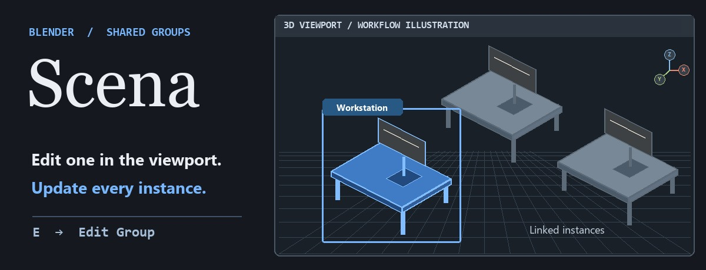

# Scena

**Edit shared object groups in place in Blender. Every linked instance updates as you work.**

[**Download Scena 0.3.1**](https://github.com/VictoryLuode/Blender-Scena/releases/download/v0.3.1/Scena-0.3.1.zip) · [All releases](https://github.com/VictoryLuode/Blender-Scena/releases) · [Install](#install) · [Quick start](#quick-start) · [User guide](docs/user-guide.md)

Requires **Blender 5.3.0 or later**. Tested in Blender 5.3.0.

- **Edit in place.** Open a group from the 3D Viewport and move its members or edit their meshes where they appear in the scene.
- **Keep copies in sync.** Place the same group across a scene and edit any instance to update the shared definition.
- **Make variants.** Choose whether a copy shares its group definition, nested groups, mesh data, or materials.

## Install

1. Download [`Scena-0.3.1.zip`](https://github.com/VictoryLuode/Blender-Scena/releases/download/v0.3.1/Scena-0.3.1.zip) from Releases.
2. In Blender, open **Edit → Preferences → Get Extensions**. Open the dropdown in the upper right and choose **Install from Disk…**.
3. Select the ZIP file. In the 3D Viewport, press **N** and open **Item → Group**. In Object Mode, press **E** to open the Scena pie menu.

## Quick start

| Step | In the 3D Viewport |
| --- | --- |
| **1. Group the objects** | Select the parts of a workstation, then choose **Group → Create Group** in the sidebar. |
| **2. Place a linked copy** | Select the group, press **Alt+D**, and move the new instance. |
| **3. Edit either copy** | Press **E → Edit Group** and move the tabletop or edit its mesh. The other instance updates as you work. Choose **E → Back** to exit. |

Press **Shift+D** to copy the top-level group definition while keeping nested groups and member meshes shared. To make an existing placement independent at a specific level, use **F3 → Make Single User**. See [Duplicate and make variants](docs/user-guide.md#duplicate-and-make-variants) for the exact sharing rules.

## Further reading

- [User guide](docs/user-guide.md) covers group types, nested editing, picking, the Group Library, modifier stacks, and preferences.
- [Performance and testing](docs/user-guide.md#performance-and-testing) documents the 1,000-instance benchmark and the tested workflows.
- [Report an issue](https://github.com/VictoryLuode/Blender-Scena/issues) with your Blender version and steps to reproduce it.

## License and credits

Scena is licensed under the [GNU General Public License v3.0 or later](scena/LICENSE). The bundled viewport icon font uses artwork by Blender contributors, derived from Blender’s [SVG interface icons](https://github.com/blender/blender/tree/02f0899d78e3/release/datafiles/icons_svg).
