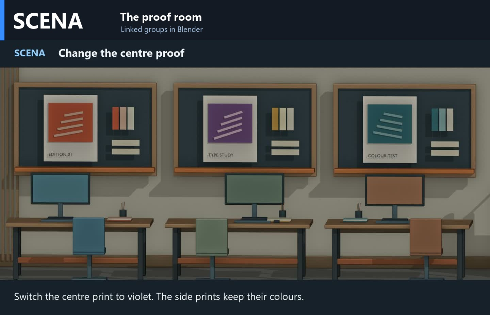
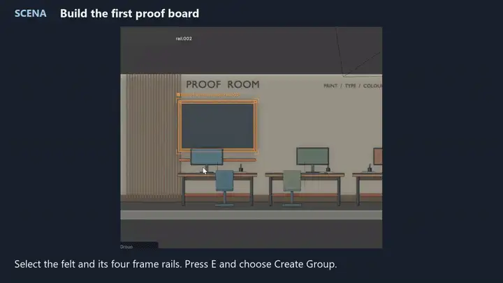

<h1 align="center">Scena</h1>

<strong>Linked groups for Blender set builders</strong>

<a href="docs/media/proof-room.mp4"><strong>▶ Watch the build · 1:05</strong></a>

  
  
  

<a href="#quick-start">Quick start</a> · <a href="#install">Install</a> · <a href="#hard-ops-on-the-main-branch">Hard Ops</a> · <a href="docs/user-guide.md">User guide</a>

## Quick start

Recreate the first row of desks from the walkthrough in Blender 5.3.

1. **Build the frame.** Select the desktop and legs. Press **E** over the selection and choose **Create Group**.
2. **Place a second desk.** Select the group and choose **Operations → Duplicate Link** (or press **Alt+D**). Move the copy to the next workstation.
3. **Brace both desks.** Select a brace and the original group, then choose **Add**. Look at the second desk to see the matching brace.

### Hang the display boards

The boards use the same workflow as the desks. Duplicate the frame for each station, then add a ledge to one frame to fit all three. Keep the prints outside the group so you can swap one independently. For a separately editable group, choose **Operations → Duplicate Group**. [See the sharing rules](docs/user-guide.md#duplicate-and-make-variants).

## Install

Download the extension ZIP from [published releases](https://github.com/VictoryLuode/Blender-Scena/releases). In Blender 5.3, open **Edit → Preferences → Get Extensions**, open the dropdown, choose **Install from Disk…** and select the ZIP.

## Hard Ops on the main branch

Enable Hard Ops and make a closed, editable Scena group the active object. Open the **Q** menu for **Solidify** or **Array**. For **Difference**, select the mesh cutter first and the group last.

These commands prepare mesh output for the active placement and preserve its shared source. To do this manually, choose **Prepare for Hard Ops**. On Geometry Nodes placements, **Convert to Mesh** selects mesh geometry when on and instances when off. Leave it off for groups whose members require instance output.

## License and credits

Scena uses the [GNU General Public License v3.0 or later](scena/LICENSE). Its bundled icon font uses artwork derived from [Blender’s interface icons](https://github.com/blender/blender/tree/02f0899d78e3/release/datafiles/icons_svg).
