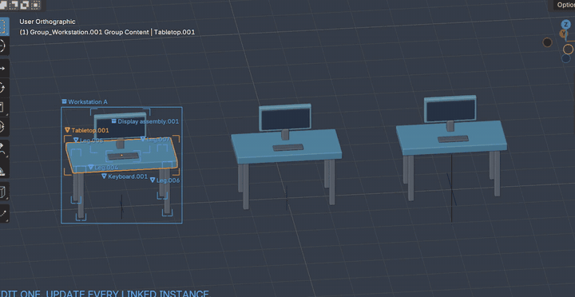
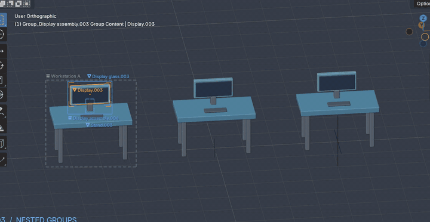
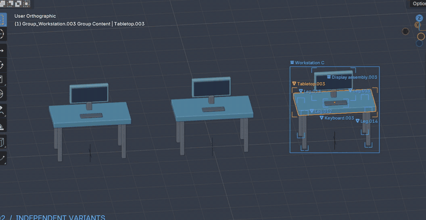

<h1 align="center">Scena</h1>

<strong>Linked group editing for Blender</strong>

Build reusable groups from scene objects, edit them in place, and keep linked copies in sync.

  <a href="https://github.com/VictoryLuode/Blender-Scena/releases/latest"><strong>Download Scena</strong></a> ·
  <a href="#quick-start">Quick start</a> ·
  <a href="#feature-demos">Feature demos</a> ·
  <a href="docs/user-guide.md">User guide</a>

  
  

<a href="docs/media/proof-room.mp4">Watch the workstation demo · 1:05</a>

## Features

- **Linked groups.** Build a desk, workstation, or modular assembly once and place copies throughout a scene. Move a member or edit its mesh in any linked placement to update the shared group.
- **In-place editing.** Enter a group at its current position in the scene. Step into nested groups, select members in the viewport, and use the scene around them as a reference.
- **Independent variants.** Duplicate the top-level group or its nested definitions. Use **Make Single User** when a placement also needs independent mesh data or materials.
- **Collection and Geometry Nodes groups.** Choose either representation and switch between them while keeping the same source collection. Geometry Nodes groups can output instances or evaluated meshes for Blender and Hard Ops modifiers.

## Install

**Requires Blender 5.3.**

1. Download the Scena extension ZIP. [Latest release](https://github.com/VictoryLuode/Blender-Scena/releases/latest)
2. In Blender, open **Edit → Preferences → Get Extensions**.
3. Open the top-right menu, choose **Install from Disk…**, and select the ZIP. Enable **Scena** if Blender leaves it disabled.

## Quick start

Open **Item → Group** in the 3D Viewport sidebar or press **E** in Object Mode to open the Scena pie menu.

1. Select the objects that make up an assembly and choose **Create Group**.
2. Select the group, press **Alt+D** or choose **Operations → Duplicate Link**, and move the copy into place.
3. Select either placement and choose **Edit**. Move a member, then choose **Back**. Both placements reflect the change.

See which data each duplication mode shares. [Duplicate and make variants](docs/user-guide.md#duplicate-and-make-variants)

## Feature demos

### Shared editing

Move the desktop on the left. The two linked workstations update as you edit.

### Nested groups

Edit the display inside the workstation's nested group, then return to the parent group.

### Independent variants

Move the desktop in an independent workstation group. The other two desktops stay in place.

## Modifiers and Hard Ops

On a Geometry Nodes group, open the **Scena Group** modifier and use **Convert to Mesh** to control what subsequent modifiers receive. Leave it off to output linked instances or turn it on to output an evaluated mesh. Scena preserves the output mode when opening older groups.

With Hard Ops enabled, make the Scena group active and use **Solidify**, **Array**, or **Difference** from the **Q** menu. Scena prepares mesh output for the active placement and keeps it linked to its source. For **Difference**, select the cutter first and the group last. [Modifier guide](docs/user-guide.md#use-modifiers)

## Support and license

Include your Blender and Scena versions and the steps to reproduce the issue when filing a bug report. [GitHub Issues](https://github.com/VictoryLuode/Blender-Scena/issues)

Scena is licensed under the GNU General Public License v3.0 or later. Its bundled icon font uses artwork derived from Blender’s interface icons. [License](scena/LICENSE) · [Blender icon artwork](https://github.com/blender/blender/tree/02f0899d78e3/release/datafiles/icons_svg)
